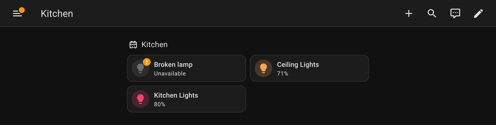
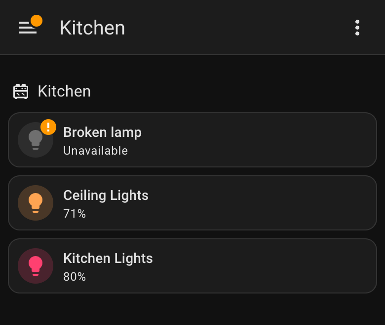

# Wall Panel Kit dashboard (preview)

A Home Assistant **dashboard strategy**: you create a new dashboard, pick *Wall Panel Kit (preview)*, choose one area, and it shows that area's lights as Home Assistant's built-in tile cards. A tablet layout (tiles in columns) or a phone layout (full-width tiles).

> **Preview, v0.1.1.** Where it stands:
>
> - **Released:** [v0.1.1](https://github.com/davidteles/ha-wall-panel-dashboard/releases/latest), with `ha-wall-panel-dashboard.js` attached. It has the same code as v0.1.0; only the version number and these docs changed.
> - **In the Marketplace:** listed in the default list since 2026-11-24 ([hacs/default#14833](https://github.com/hacs/default/pull/14833)), so searching the Marketplace for *Wall Panel Kit* finds it (see [Using it](#using-it)).
>
> Installing, updating and removing it passed on a throw-away Home Assistant 2026.11.3 with demo data ([acceptance results](docs/acceptance.md#results)). Installing the published v0.1.0 release itself (the same code) passed too, on 2026-11-24 ([released-file checks](docs/acceptance.md#released-file-v010)). It has not been used in a real home. Don't rely on it yet.

| Tablet | Phone |
|---|---|
|  |  |

<sub>Screenshots from a test Home Assistant with demo devices.</sub>

## How it relates to the Wall Panel Kit

The [Wall Panel Kit](https://github.com/davidteles/ha-wall-panel-kit) is a generator: you describe your home in a YAML file, run a Python script on your computer, and paste the dashboards it writes. That is still the way to get the full wall panel (alarm, Entry, laundry, Leaving, kiosk, theme).

This repo is a separate, much smaller experiment: a dashboard that Home Assistant builds by itself, in the browser, from your areas. No Python, no YAML to paste. For now it does one thing only. It has none of the kit's automations, blueprints or theme, and it doesn't replace or convert a dashboard made with the kit: the two are used separately.

| | Wall Panel Kit (generator) | This preview |
|---|---|---|
| How you get it | Run `tools/render.py`, paste YAML | Search the Marketplace, install, then *Add dashboard* |
| What it shows | Everything in the kit | One area's lights |
| Extra cards needed | Yes (Mushroom, card-mod, …) | None, built-in tile cards only |
| Status | Released | Preview (v0.1.1), demo-tested only |

## What it does, and what it never does

- Shows only `light.*` entities in the chosen area: lights assigned to the area directly, or through their device. Hidden lights and configuration/diagnostic entities are left out. Unavailable lights are still shown, marked unavailable.
- Never lists other kinds of entities (locks, alarm, cameras, sensors, switches…), even in the same area.
- An empty or deleted area shows a short message instead of an error.
- Makes no service calls, no network requests and no tracking. It reads only what Home Assistant already gives the dashboard, and never changes an existing dashboard or your configuration.
- Installing it does not change who can see what: dashboard visibility and user permissions stay as you set them in Home Assistant.

## Requirements

Home Assistant **2026.11** or newer (the built-in Marketplace and the *Community dashboards* picker). Older Home Assistant versions and the older HACS add-on are not tested, so they are not supported.

## Using it

1. **Settings → Marketplace**, search for **Wall Panel Kit**, open *Wall Panel Kit (preview)*, then **Install**, and reload the browser. (If it doesn't show up yet, your Marketplace data may not have refreshed: use **Add from link** with this repository's address, `https://github.com/davidteles/ha-wall-panel-dashboard`, and choose **Dashboard** if asked.)
2. **Settings → Dashboards → Add dashboard → Community dashboards → Wall Panel Kit (preview)**.
3. Edit the new dashboard and choose an area and a layout.

To remove it: delete the dashboard you made with it, then **Settings → Marketplace →** this repository **→ Uninstall** (this also removes its resource), and reload the browser. Nothing else was added, so there is nothing else to undo. This was checked in the [acceptance run](docs/acceptance.md#results).

The same in YAML (a dashboard in YAML mode):

```yaml
strategy:
  type: custom:wall-panel-kit
  area: kitchen      # the area id
  layout: tablet     # or: phone
```

## Development

No dependencies and no build step: [`dist/ha-wall-panel-dashboard.js`](dist/ha-wall-panel-dashboard.js) is both the source and the file the Marketplace installs.

```bash
npm test
```

See [CONTRIBUTING.md](CONTRIBUTING.md) and [docs/acceptance.md](docs/acceptance.md).

## License

MIT
